<p align="center">
  
</p>

<h1 align="center">Static OS</h1>

<p align="center">
  <a href="https://github.com/0xzerox0/poster-pilot/releases/latest"></a>
  
  <a href="https://github.com/0xzerox0/poster-pilot/actions/workflows/deploy.yml"></a>
  <a href="https://0xzerox0.github.io/poster-pilot/"></a>
  <br>
  
  
  
  
  
</p>

<p align="center">
  <a href="https://0xzerox0.github.io/poster-pilot/"><b>Open the app</b></a> ·
  <a href="https://github.com/0xzerox0/poster-pilot/releases/latest">Latest release</a> ·
  <a href="#screenshots">Screenshots</a>
</p>

The Static team's workspace, in one place: the shop price list, a PC build quotation tool, the
maintenance and warranty desk, and the control panel for the product poster pipeline (offers,
review, fixes, the week plan and the Facebook and Instagram planner). The heavy work (finding
photos, building posters, checking competitor prices, syncing the website, posting on time) runs
in n8n workflows, which read and write the same Firestore database as the app.

It installs on Android from Chrome ("Add to Home screen") and runs in any browser, in English or
Arabic, light or dark.

<p align="center">
  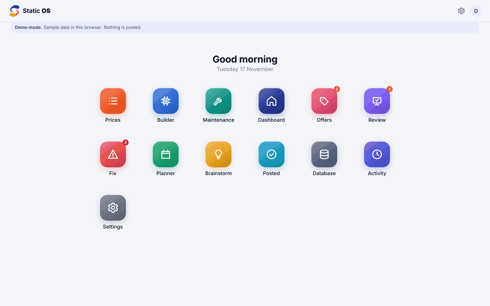
  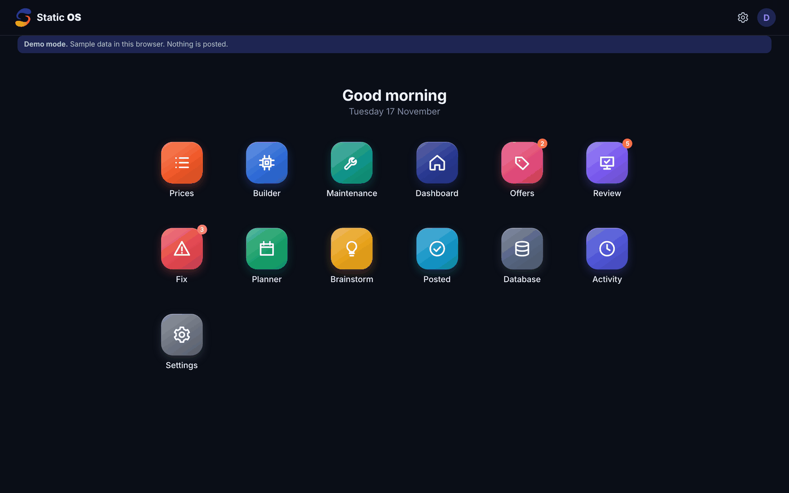
</p>

## Apps

The home screen is a grid of apps, each opening on its own screen with its own top bar. Anyone who
prefers the old sidebar can switch back in Settings.

| Group | App | What it is for |
| --- | --- | --- |
| Shop | Prices | The price list by category: stock, cost and profit (for those allowed), website prices and links, as a table or as cards |
| Shop | Builder | PC builds with fit checks, totals and discounts, saved and live quotes, and a printed quotation (A4 or A5, with or without prices) |
| Shop | Maintenance | Repair and warranty tickets: steps, deadlines, WhatsApp updates and an A5 receipt |
| | Dashboard | Counts for review, fix, scheduled and posted today, plus what goes out next |
| Posters | Offers | New product offers (1 to 3 products, or up to 4 versions of one product), photo picker from the website, search and approval |
| Posters | Review | Finished posters: Approve, Redo, Skip, or Post now on Facebook and Instagram |
| Posters | Fix | Every post with a problem, with the reason and the way to fix it |
| Posters | Planner | Month and day views of scheduled and posted posts, drag to plan |
| Posters | Brainstorm | The week plan, before anything gets a date |
| Posters | Posted | History, newest first |
| Posters | Database | Every post in one table |
| Team | Activity | Who did what, across the whole app |
| | Settings | Language, layout, profile photo and name, people, roles and permissions, caption templates |

## Screenshots

<table>
  <tr>
    <td width="50%">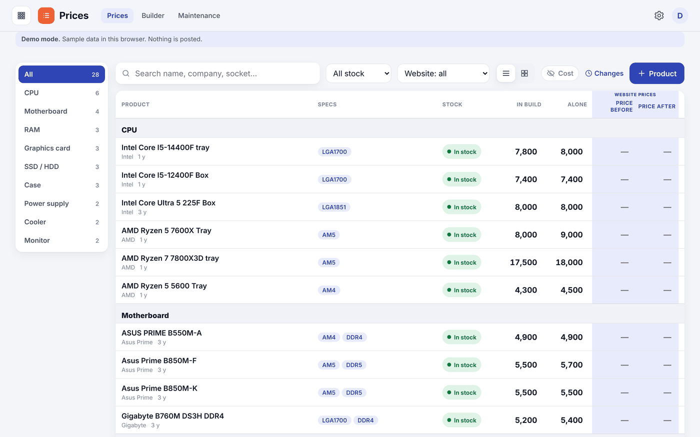<br><b>Prices</b>: the whole price list, with stock and website prices</td>
    <td width="50%">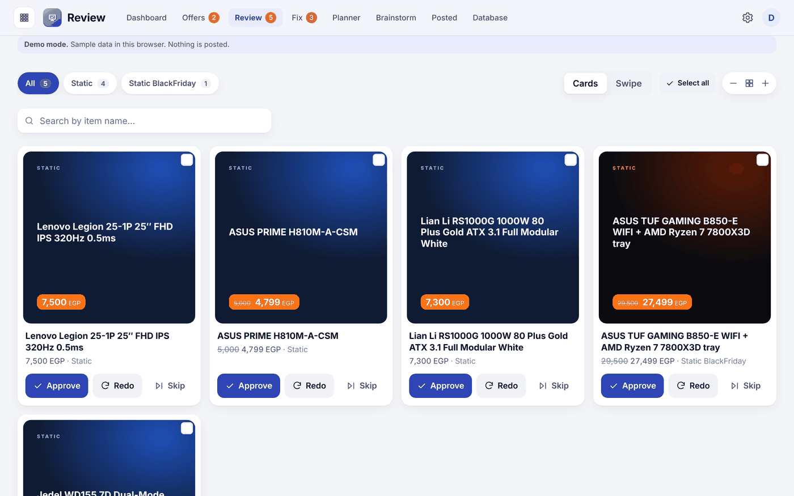<br><b>Review</b>: approve finished posters</td>
  </tr>
  <tr>
    <td>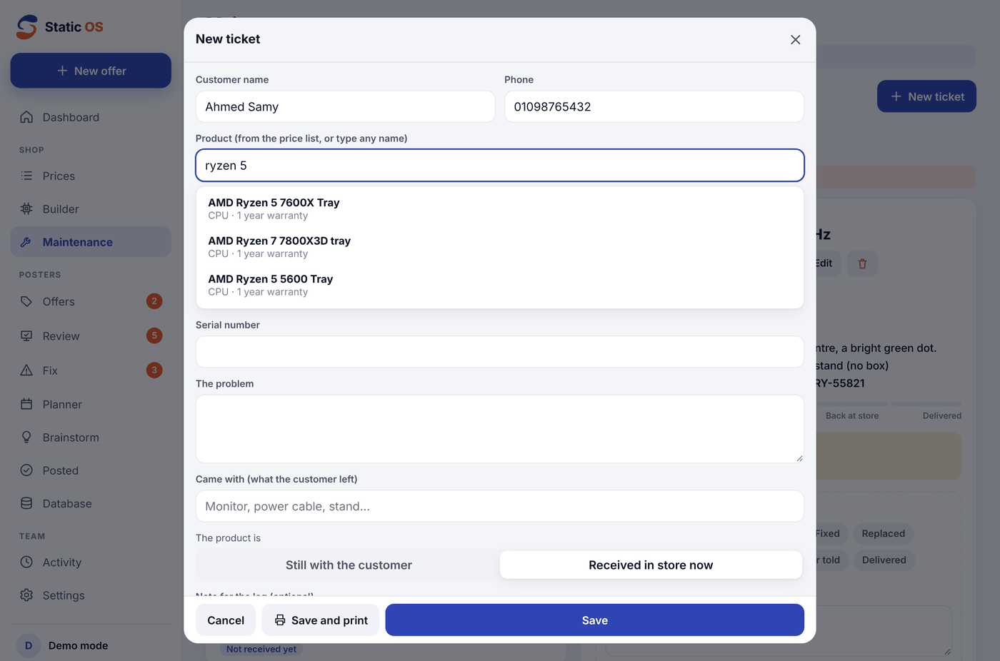<br><b>Maintenance</b>: a new ticket, product picked from the price list</td>
    <td>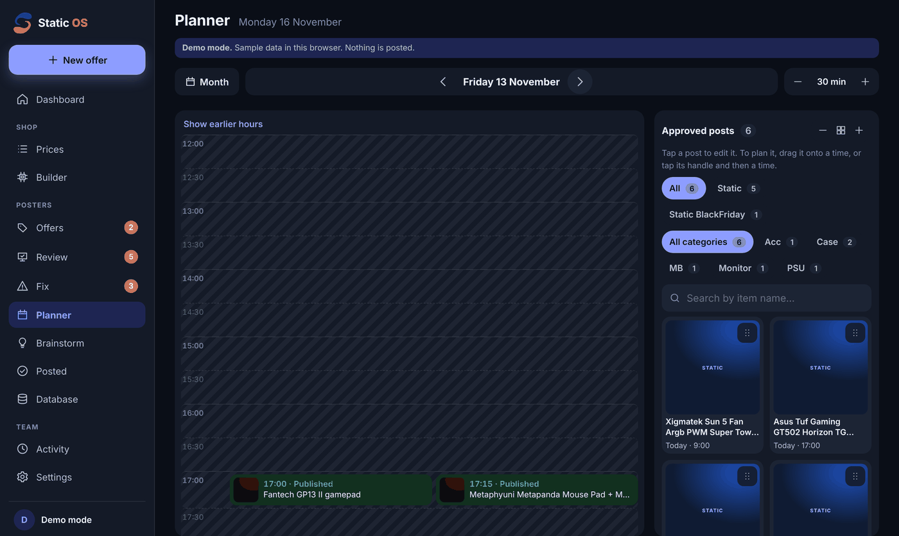<br><b>Planner</b>: the day view, drag approved posts onto a time</td>
  </tr>
  <tr>
    <td>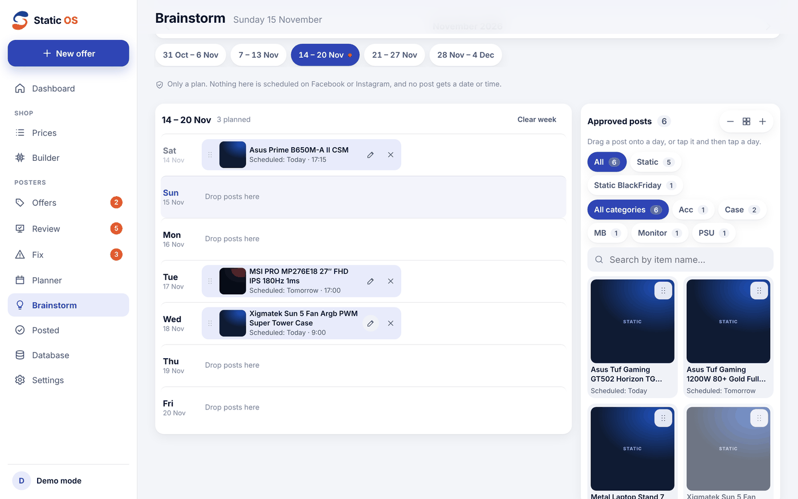<br><b>Brainstorm</b>: plan the week first</td>
    <td>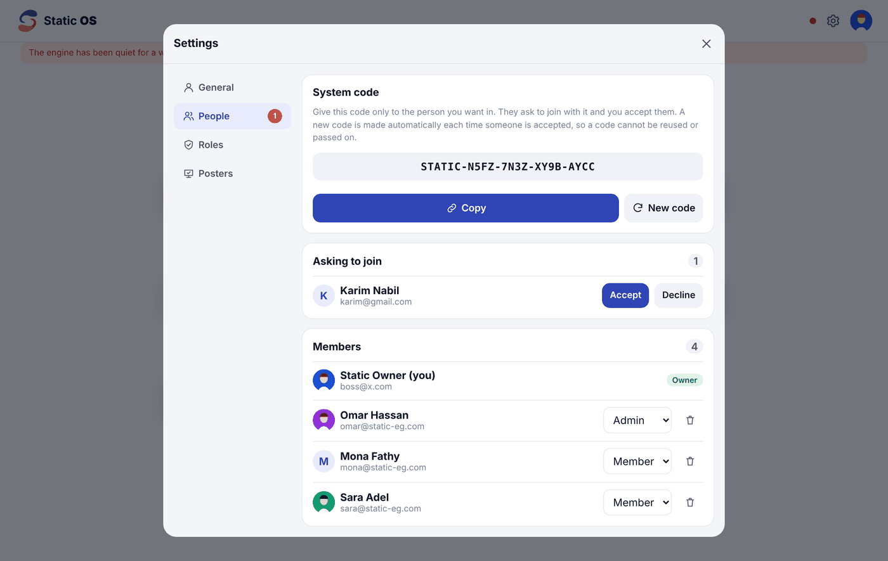<br><b>Settings</b>: system code, join requests, members and roles</td>
  </tr>
</table>

On a phone:

<p align="center">
  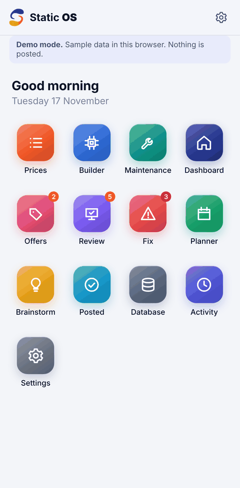
  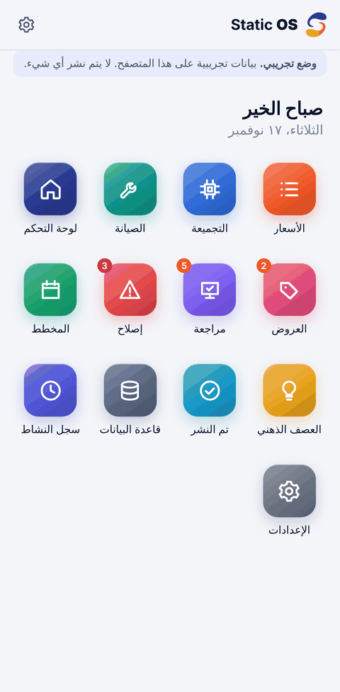
  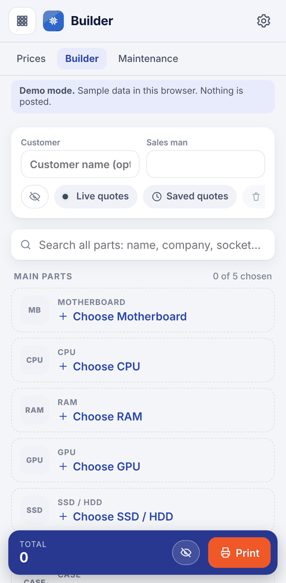
  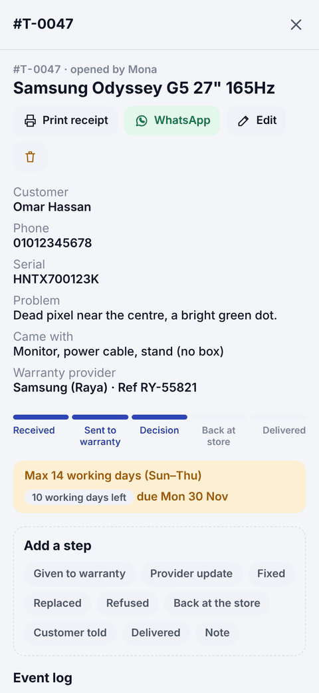
  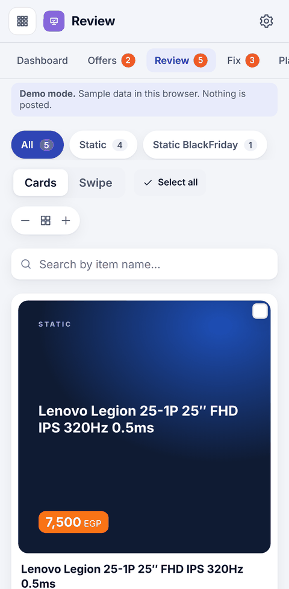
  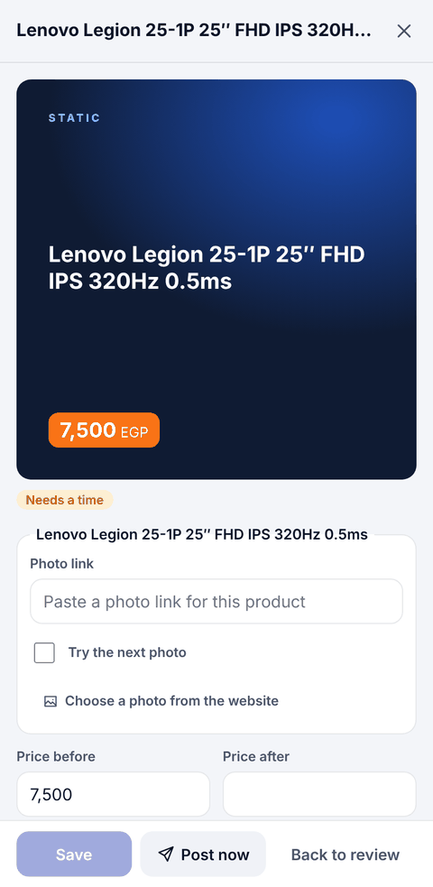
</p>

All screenshots are from demo mode, with sample data.

## Run it

```
npm install
npm run dev
```

With no Firebase values the app runs in **demo mode**: sample data kept in the browser and a
pretend engine, so every button can be tried. Nothing is posted.

To connect it to Firebase, copy `.env.example` to `.env.local` and fill in the values from the
Firebase console (Project settings, Your apps, Web app). Then:

1. Authentication: turn on Google sign-in, and add the site's domain under Authorized domains.
2. Firestore: create the database and publish `firestore.rules`.
3. In Firestore, create the document `config/access` with a list field `emails`. Its first email
   becomes the owner the first time that person opens the app; the others on it become members.

Everyone else joins with the system code: the owner copies it from Settings, the new person pastes
it after signing in, and an owner or admin accepts the request. The code alone opens nothing.
The owner can make custom roles, each with its own permissions and pages. `tests/rules/rules.test.mjs` checks the rules against the Firestore
emulator (`npm run test:rules`, with Java, `firebase-tools` and `@firebase/rules-unit-testing` installed).

The published site reads the same values from `.env.production`, which is committed: they are the
web app's public identifiers, not secrets. Access is protected by the rules and the access list.

## How the data is laid out

| Document | Holds |
| --- | --- |
| `prices/{category}` | The price list, one document per category (`prices/_meta` holds the version) |
| `costs/{category}` | Cost prices, readable only by roles allowed to see cost |
| `posts/{id}` | One post, the fields of `Post` in `src/data/types.ts` |
| `log/{id}` | The history of one post, from the app and from n8n |
| `plans/{week}` | The Brainstorm week plan |
| `tickets/{id}` | One maintenance ticket and its steps |
| `quotes/{id}`, `drafts/{uid}`, `edits/{uid}` | Saved quotes, live quotes and edits to someone else's live quote |
| `activity/{id}` | The app-wide activity list |
| `catalog/products` | `{ items }`, the product list used by the search |
| `catalog/styles` | `{ names }`, the background styles |
| `catalog/templates` | `{ items }`, the caption templates |
| `status/engine` | `{ lastSync, note }`, written by n8n so the app can show it is alive |
| `config/access` | `{ emails }`, the first list: owner first, then the first members |
| `members/{uid}` | `{ email, name, role, joinedAt }`, the people inside |
| `profiles/{uid}` | The name and photo shown next to each person |
| `roles/{id}` | Custom roles and their permissions |
| `requests/{uid}` | `{ email, name, code, createdAt }`, someone waiting to be accepted |
| `secret/code` | `{ code }`, the system code, readable by owner and admins |

A change made in the app is also listed in the post's `appEdits` map (a new post has
`appNew`, a deleted one `appDeleted`). n8n carries the change out and removes the entry.
The n8n workflows themselves are kept as code in `n8n/`.

## Commands

| Command | Does |
| --- | --- |
| `npm run dev` | Local development server |
| `npm test` | Unit tests |
| `npm run build` | Type-check and build into `dist` |
| `npm run lint` | Lint |
| `npm run check:n8n` | Check that every n8n code file in `n8n/` can be read by JavaScript |
| `npm run test:rules` | Database rules checks against the Firestore emulator |

Every pull request runs `.github/workflows/checks.yml`: lint, unit tests, type-check and build,
the n8n code check, and the database rules checks. A pull request is merged only when these
are green and it has no conflicts.

Every push to `main` is tested, built and published to GitHub Pages by
`.github/workflows/deploy.yml` (the badge at the top shows its last result).

## Releases

The version is the one in `package.json`. On every push to `main`,
`.github/workflows/release.yml` checks whether that version has a release yet. If not, it tags it
and publishes a normal, stable GitHub release (never a pre-release) with the changes since the
last one. To make a new release, raise the version in the pull request, for example with
`npm version minor --no-git-tag-version`.
